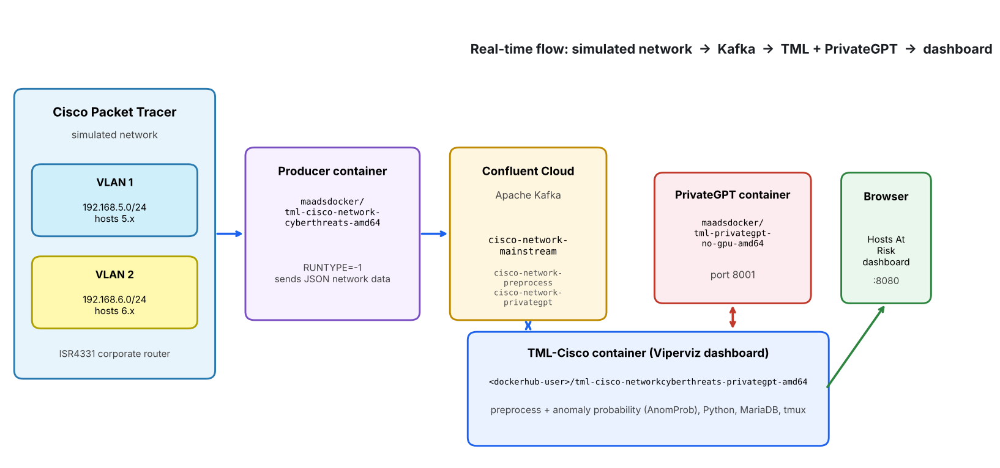
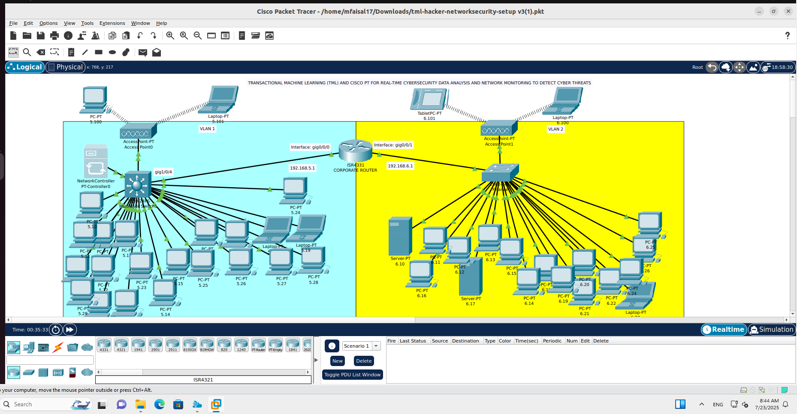

# TML-Cisco Cyberthreat Detection: Real-Time Network Monitoring with Kafka, Docker and PrivateGPT
A hands-on cybersecurity lab that detects compromised and offline hosts in a **Cisco Packet Tracer** network in real time. Network data is streamed into **Apache Kafka on Confluent Cloud**, processed by a **Transactional Machine Learning (TML)** container that scores each host's inbound and outbound traffic for anomalies, analysed by a **PrivateGPT** container, and shown on a live **Hosts At Risk** dashboard. The solution runs in **Docker** on an **Ubuntu** VM, with **Python**, **MariaDB** and **tmux** inside the TML container.


**Last updated:** November 2026

---

## 📚 Project Objectives
- Detect, in real time, which hosts in a simulated Cisco network have been attacked or taken offline, without knowing the targets in advance
- Set up and connect to a **Kafka cluster on Confluent Cloud** and confirm the network data arrives in the `cisco-network-mainstream` topic
- Containerize the **TML-Cisco** solution with Docker and run it with the Kafka connection settings
- Run the **PrivateGPT** container alongside it so the dashboard can show AI analysis
- Open the **Hosts At Risk** dashboard and read host risk, packet statistics and anomaly probabilities
- Answer the 16 dashboard questions (hosts at risk, packet averages, maximums, trends, variance, anomaly probability above 80%)
- Document the components, how they are integrated, and how the solution would scale ([docs/solution-writeup.md](docs/solution-writeup.md))

---

## 🗺️ Architecture


**Packet Tracer network** (the attack target):



> The network has two VLANs behind one ISR4331 router: VLAN 1 (`192.168.5.0/24`, hosts `5.x`) and VLAN 2 (`192.168.6.0/24`, hosts `6.x`). Details are in [docs/architecture.md](docs/architecture.md).

---

## 📂 Repository Layout
```
TML-Cisco-Cyberthreat-Detection-PrivateGPT-Docker/
├── configs/
│   └── tml-cisco.env.example        # Container settings (copy to tml-cisco.env, never commit it)
├── diagrams/
│   └── architecture.png             # Data flow from the network to the dashboard
├── docs/
│   ├── architecture.md              # Components, topics, ports and design notes
│   ├── setup.md                     # Step-by-step build guide
│   ├── verification.md              # Every check, with expected output
│   ├── questions.md                 # The 16 dashboard questions
│   ├── solution-writeup.md          # Problem, solution, components, scaling
│   └── submission.md                # Project summary and references
├── screenshots/                     # Proof of each deliverable
├── scripts/
│   ├── run-privategpt.bash          # Start the PrivateGPT container
│   ├── run-tml-cisco.bash           # Start the TML-Cisco container from an env file
│   └── verify-solution.bash         # Optional helper to run the checks
├── .gitignore
└── README.md
```

---

## 🧰 Requirements
- An Ubuntu VM (VMware Workstation) with Docker installed (`sudo apt-get install docker.io`)
- A **Confluent Cloud** account with a Kafka cluster, its bootstrap server, and an API key and secret
- The TML-Cisco image (built from the upstream `tml-cisco-pt/docker` Dockerfile and pushed to your Docker Hub account)
- The PrivateGPT image `maadsdocker/tml-privategpt-no-gpu-amd64`
- Cisco Packet Tracer with the provided network file, running on another machine that sends the network data
- A web browser on the VM (Firefox or Chrome)

> **Keep your credentials private.** The Kafka API key and secret are passed to the container with an env file that is ignored by git. Never paste them into the README, a screenshot or a commit.

---

## ⚙️ Setup

Full walkthrough: [docs/setup.md](docs/setup.md). The short version:

1. Create the Kafka cluster in Confluent Cloud and note the bootstrap server, API key and API secret.

2. Start the PrivateGPT container:

   ```bash
   docker run -d -p 8001:8001 --env PORT=8001 --env GPU=0 \
     --env CUDA_VISIBLE_DEVICES=0 maadsdocker/tml-privategpt-no-gpu-amd64
   ```

3. Put your settings in an env file (a template is in [configs/tml-cisco.env.example](configs/tml-cisco.env.example)), then start the TML-Cisco container:

   ```bash
   cp configs/tml-cisco.env.example configs/tml-cisco.env
   vim configs/tml-cisco.env
   ./scripts/run-tml-cisco.bash configs/tml-cisco.env
   ```

   This is the assignment's command, with the credentials supplied as variables:

   ```bash
   docker run -d -p 8080:8080 --net host \
     --env VIPERVIZPORT=8080 --env RUNTYPE=-2 \
     --env PGPTIP="http://127.0.0.1" --env PGPTPORT=8001 --env PGPTROLLBACK=4 \
     --env BROKERHOSTPORT=<bootstrap-server>:9092 \
     --env KAFKAPRODUCETOPIC=cisco-network-mainstream \
     --env CLOUDUSERNAME=<confluent-api-key> \
     --env CLOUDPASSWORD=<confluent-api-secret> \
     <dockerhub-username>/tml-cisco-networkcyberthreats-privategpt-amd64
   ```

4. Check that both containers are running:

   ```bash
   docker container ls
   ```

5. Open the dashboard in a browser and press **START STREAMING**:

   ```
   http://localhost:8080/tml-cisco-network-privategpt-monitor.html?topic=cisco-network-preprocess,cisco-network-privategpt&offset=-1&groupid=&rollbackoffset=150&topictype=prediction&append=0&secure=1
   ```

6. Start the Packet Tracer simulation so network data flows into Kafka. The dashboard lists the hosts at risk as the attack happens.

---

## 🐳 Containers

| Container | Image | Port | Purpose |
|-----------|-------|------|---------|
| TML-Cisco | `<dockerhub-username>/tml-cisco-networkcyberthreats-privategpt-amd64` | 8080 (dashboard) | Reads Kafka, scores anomalies, serves the dashboard |
| PrivateGPT | `maadsdocker/tml-privategpt-no-gpu-amd64` | 8001 | AI analysis of the processed data |
| Data producer | `maadsdocker/tml-cisco-network-cyberthreats-amd64` | host network | Sends the network data to `cisco-network-mainstream` (`RUNTYPE=-1`) |

---

## ✅ Usage & Verification

Every check below has expected output and a screenshot in [docs/verification.md](docs/verification.md).

**Containers running**

```
$ docker container ls
CONTAINER ID   IMAGE                                                    PORTS
f6efe8a40ad7   maadsdocker/tml-privategpt-no-gpu-amd64                  0.0.0.0:8001->8001/tcp
b0f460a90994   <dockerhub-username>/tml-cisco-networkcyberthreats-…     0.0.0.0:9000->9000/tcp
```

**Dashboard** – the capture shows `112839` Kafka messages processed, `5 out of 42` hosts at potential risk (anomaly probability above 0.85), and the banner:

```
Hosts At Risk: 5.11,5.16,6.17 - Anomalies Found in Hosts: 5.14,5.31
```

**Anomaly detail** – hovering a host shows its inbound and outbound anomaly probability, for example `192.168.6.13` with `0.758 (75.80%)` inbound and `0.711 (71.10%)` outbound.

**Kafka** – the Confluent Cloud topic `cisco-network-mainstream` shows the JSON messages arriving (about 67,000 in the last hour in the capture).

---

## 🔍 How It Works
1. **Simulated network** – Cisco Packet Tracer hosts, switches and a router produce network data. The producer container sends it as JSON to the Kafka topic `cisco-network-mainstream`.
2. **Kafka on Confluent Cloud** – The topic holds the continuous stream. It is fault tolerant and keeps messages for a week.
3. **TML processing** – The TML-Cisco container reads the JSON, groups it into time windows, and calculates inbound and outbound packet statistics (maximum, average, variance, trend) and an **anomaly probability** for each host.
4. **Hosts at risk** – A host whose anomaly probability is above the threshold (0.85) is flagged. Results go to the topic `cisco-network-preprocess`.
5. **PrivateGPT** – The processed data is sent to PrivateGPT on port 8001, and its short written assessment of each host goes to the topic `cisco-network-privategpt`.
6. **Dashboard** – Viperviz reads both topics and shows the Hosts At Risk banner, pie charts, anomaly probability bars, the data table and the PrivateGPT answers in real time.
7. **Containers** – Each service runs in Docker, so the solution starts the same way on any Ubuntu VM.

---

## 🖼️ Screenshots
| # | Screenshot | File |
|---|------------|------|
| 1 | Cisco Packet Tracer network diagram | [01-cisco-packet-tracer-network-diagram.png](screenshots/01-cisco-packet-tracer-network-diagram.png) |
| 2 | Dashboard with hosts at risk | [02-dashboard-hosts-at-risk.png](screenshots/02-dashboard-hosts-at-risk.png) |
| 3 | Anomaly probability detail for a host | [03-dashboard-anomaly-probability-detail.png](screenshots/03-dashboard-anomaly-probability-detail.png) |
| 4 | Confluent Cloud topic `cisco-network-mainstream` | [04-confluent-cloud-topic-messages.png](screenshots/04-confluent-cloud-topic-messages.png) |
| 5 | `docker run` for PrivateGPT | [05-docker-run-privategpt.png](screenshots/05-docker-run-privategpt.png) |
| 6 | `docker run` for the TML-Cisco container (credentials hidden) | [06-docker-run-tml-cisco-container.png](screenshots/06-docker-run-tml-cisco-container.png) |
| 7 | `docker container ls` with both containers | [07-docker-container-ls.png](screenshots/07-docker-container-ls.png) |
| 8 | Stopping and restarting the producer container (credentials hidden) | [08-docker-stop-and-rerun-producer-container.png](screenshots/08-docker-stop-and-rerun-producer-container.png) |

---

## 📖 References
- [Docker Hub](https://hub.docker.com/)
- [PrivateGPT container on Docker Hub](https://hub.docker.com/repository/docker/maadsdocker/tml-privategpt-no-gpu-amd64/general)
- [smaurice101/raspberrypi – tml-cisco-pt/docker](https://github.com/smaurice101/raspberrypi/tree/main/tml-cisco-pt/docker)
- [smaurice101/raspberrypi – repository](https://github.com/smaurice101/raspberrypi)
- [Confluent Cloud documentation](https://docs.confluent.io/cloud/current/overview.html)
- [TML-Cisco solution video](https://www.youtube.com/watch?v=dVM2yz7wdQA)
- [TML-Cisco-PrivateGPT quick video](https://www.youtube.com/watch?v=foZQJcnSXcs)
