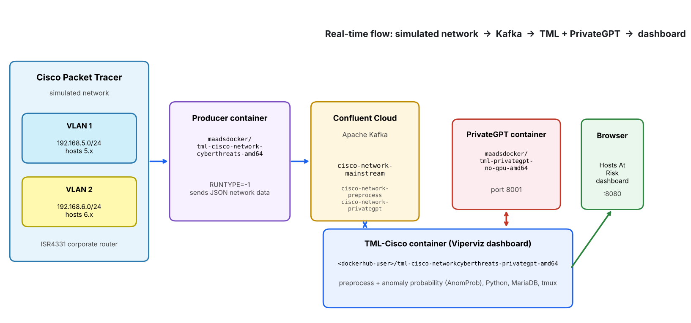
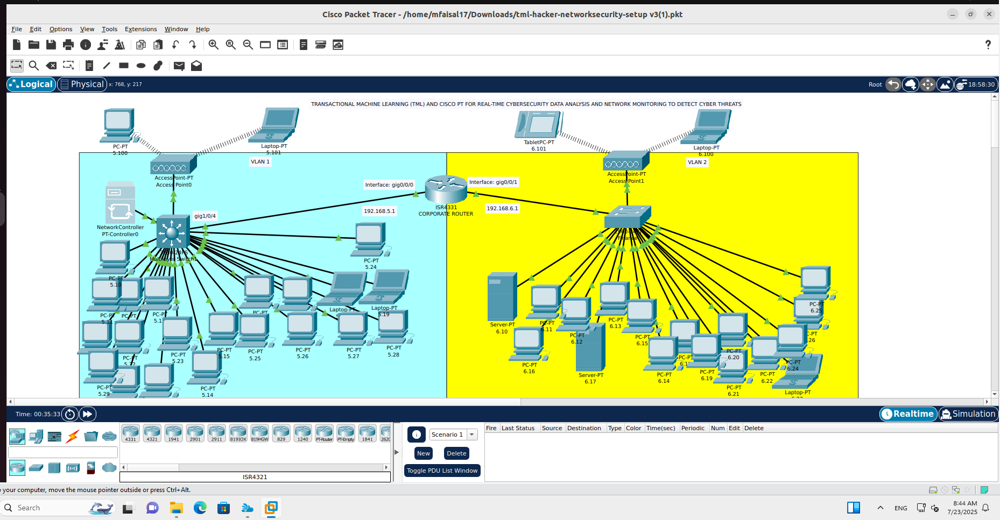

# 🗺️ Architecture

This document describes how the pieces of the lab fit together.

> The diagram is drawn for this repository. The Docker Hub ID is shown as `<dockerhub-username>` and the Kafka connection details are left out.

---

## The Packet Tracer Network

| Part | Detail |
|------|--------|
| Router | ISR4331 corporate router |
| VLAN 1 | `192.168.5.0/24`, router interface `gig0/0/0` (`192.168.5.1`), hosts `5.x`, a multilayer switch, an access point and a network controller |
| VLAN 2 | `192.168.6.0/24`, router interface `gig0/0/1` (`192.168.6.1`), hosts `6.x`, a switch, an access point, two servers (`6.10`, `6.17`) |
| Purpose | The hosts generate the traffic that is analysed. An attacker hacks or shuts down hosts during the demonstration |

The IP addresses and default gateways were already set in the provided Packet Tracer file, and they are the host names that appear on the dashboard (for example `5.11` or `192.168.6.13`).

---

## Components

| Component | Role | Notes |
|-----------|------|-------|
| Cisco Packet Tracer | Simulated network | Runs on a separate machine |
| Producer container | Sends the network data as JSON | `maadsdocker/tml-cisco-network-cyberthreats-amd64`, `RUNTYPE=-1` |
| Confluent Cloud (Kafka) | Streams the data | Topic `cisco-network-mainstream` holds the raw data |
| TML-Cisco container | Processes the data and serves the dashboard | Python, MariaDB, tmux and Viperviz inside |
| PrivateGPT container | AI analysis | `maadsdocker/tml-privategpt-no-gpu-amd64`, CPU only |
| Dashboard | Real-time view | `tml-cisco-network-privategpt-monitor.html` |

---

## Kafka Topics

| Topic | Written by | Purpose |
|-------|-----------|---------|
| `cisco-network-mainstream` | Producer container | Raw JSON network data |
| `cisco-network-preprocess` | TML-Cisco container | Preprocessed statistics and anomaly probabilities |
| `cisco-network-privategpt` | PrivateGPT integration | Written assessment of each host |

---

## Ports

| Port | Where | Purpose |
|------|-------|---------|
| 8080 | TML-Cisco container | Dashboard (`VIPERVIZPORT=8080`) |
| 8001 | PrivateGPT container | PrivateGPT API (`PGPTPORT=8001`) |
| 9092 | Confluent Cloud | Kafka bootstrap server (outbound) |

---

## Design Notes

- **Dashboard port:** The assignment uses port `8080`. The captures were taken with the dashboard on port `9000` (`--env VIPERVIZPORT=9000`, `-p 9000:9000`). The port in the dashboard URL must match `VIPERVIZPORT`.
- **Host network:** The assignment's command uses both `-p` and `--net host`. With `--net host` the container shares the VM's network, so the `-p` mapping has no effect.
- **Credentials:** The Confluent API key and secret grant access to the cluster. This repo keeps them in an ignored env file and passes the secret to Docker by name, so it is not written in the command line.
- **Topic names:** The assignment sheet wraps the topic names across lines. The correct names are `cisco-network-mainstream`, `cisco-network-preprocess` and `cisco-network-privategpt`.
- **Run types:** The captures use `RUNTYPE=-1` for the producer container and `RUNTYPE=-2` for the dashboard container, as in the assignment.
